# 🛸 Aerial Documentation Matrix

Welcome to **Aerial Docs**, your personal living documentation and architecture portal with native **Mermaid.js** diagram rendering!

> [!NOTE]
> **Dynamic User Documentation**: This portal dynamically serves Markdown (`.md`) files from your private configuration repository (`aerial-config/docs/`).

---

## ⚡ System Architecture Topology

```mermaid
flowchart TB
    subgraph Ingress ["🌐 Ingress & Edge Layer"]
        DiscordUser(["Discord User / Gateway"])
        WebBrowser(["Web Browser / Client"])
        Synapse["synapse (:4020)
• Discord Gateway WebSocket & JetStream Ingress
• GitHub & Flux Event Forwarder"]
        LanGW["lan-gateway (:80 / :443)
NGINX Gateway Fabric"]
        EdgeGW["edge-gateway (:4021)
External Webhook Ingress"]
    end

    subgraph CoreAI ["🧠 Core Execution & AI Services"]
        Eri["eri (:8080)
• Distroless HTTP Ingress Front Door
• Voice & Prompt Execution Pipeline"]
        EriRestate["eri-restate (:9080 / :4028)
• Multi-Engine Execution Worker (agy, claude, codex, muse)
• Restate Sessions & TurnRunner"]
        Haro["haro (:4005 / :9080)
Persistent Scheduler & Event Watches"]
        Coven["coven (:4008 / :9080)
Semantic Fact Extraction & Memory Decay"]
        Vanadis["vanadis (:4025)
Multi-Chunk Build Queue Orchestrator"]
        VanadisNats["vanadis-nats (:4027)
JetStream-to-Restate Consumer Bridge"]
        VanadisRestate["vanadis-restate (:9080 / :4026)
Restate Build & PR Workflow Worker"]
        Transcripts["transcripts (:4030)
Session Summaries & Step Logs"]
        Pjev["pjev (:8000)
System-1 Ambient Triage (/v1/systemone)"]
        Senses["senses (:8880 / :10300)
STT, TTS, Embeddings & Wyoming"]
    end

    subgraph Persistence ["💾 Persistence & GitOps"]
        Postgres[("postgres (:5432 / :9187)
• CloudNativePG PostgreSQL 19 + pgvector
• Relational, Vector & Memory Persistence")]
        Nats["nats (:4222 / :8222)
NATS 2 JetStream Broker"]
        Restate["restate (:8080 / :9070)
Restate Durable Execution Cluster"]
        Flux["flux-system
Flux CD k3s Reconciler (./k8s)"]
        GitSync["git-sync sidecars
Mounts /share/aerial:ro & /share/aerial-config:ro"]
    end

    subgraph WebServices ["📊 Web & Documentation Microservices"]
        Homepage["homepage (:3001)
Service Discovery HUD"]
        Console["console (:8084)
Live Cluster Status HUD"]
        Docs["docs (:80)
Docsify + Mermaid Engine"]
        Agentsview["agentsview (:8080)
Transcript Visualizer"]
    end

    subgraph Observability ["📈 Full-Stack Observability"]
        OtelCollector["otel-collector (:4317)
OpenTelemetry Ingestion Collector"]
        Victoria["victoriametrics (:8428)
Single-Node Prometheus TSDB"]
        VMAlert["vmalert (:8880)
Anomaly Alert Rule Evaluator"]
        Grafana["grafana (:3000)
Visual Telemetry Dashboards"]
        VLogs["victorialogs (:9428)
LogsQL Log Store"]
        VTraces["victoriatraces (:10428)
OTLP Trace Store"]
        FluentBit["fluent-bit
Container Log Forwarder"]
        NodeExp["node-exporter (:9100)
Host System Metrics"]
        CAdvisor["kubelet-cadvisor (:10250)
Kubelet Container Metrics"]
    end

    %% Ingress flow
    DiscordUser -->|Gateway WebSocket| Synapse
    Synapse -->|POST /internal/discord/message\nPOST /internal/discord/interaction| Eri
    Synapse -->|Restate PRObject / RepoObject| Restate
    WebBrowser --> LanGW
    WebBrowser --> EdgeGW
    LanGW --> Homepage
    LanGW --> Console
    LanGW --> Docs
    LanGW --> Agentsview
    LanGW --> Grafana
    LanGW --> VLogs
    LanGW --> VTraces

    %% Core interactions
    Eri --> EriRestate
    EriRestate --> Restate
    EriRestate --> Postgres
    Haro --> Postgres
    Haro --> Restate
    Coven --> Postgres
    Coven --> Restate
    Vanadis --> Postgres
    Vanadis --> Nats
    VanadisNats --> Restate
    VanadisRestate --> Restate
    VanadisRestate --> Nats
    Transcripts --> Postgres
    Synapse --> Nats

    %% GitOps & Persistence
    Flux --> GitSync

    %% Observability Scrapes & Logs
    Victoria -->|Scrapes| Postgres
    Victoria -->|Scrapes| NodeExp
    Victoria -->|Scrapes| CAdvisor
    Victoria -->|Scrapes| Eri
    Victoria -->|Scrapes| Synapse
    VMAlert --> Victoria
    Grafana -->|PromQL| Victoria
    FluentBit -->|Ships Logs| VLogs
    LanGW -->|OTLP Spans| OtelCollector
    OtelCollector -->|OTLP Spans| VTraces
    Grafana -->|LogsQL| VLogs
    Grafana -->|Traces| VTraces
```



---

## 📂 Recommended Configuration Directory Structure

In your `aerial-config` repository:

```text
aerial-config/
├── config.yaml               # Core agent, model & channel configuration
├── rules/                    # System persona overrides & preferences
│   ├── common/
│   ├── persona/
│   ├── discord/
│   └── voice/
├── channels/                 # Per-channel operational instructions
│   └── lounge.md
├── custom-skills/            # Private operational runbooks & domain skills
├── homepage/                 # Service discovery cards & bookmarks
├── k8s/                      # User-defined Kubernetes manifests & Kustomizations
├── services/                 # Dedicated service configuration files & dashboards
│   ├── {synapse,haro,coven,vanadis}/
│   └── grafana/dashboards/
└── docs/                     # Living Docsify documentation portal
    ├── README.md             # Docs homepage
    ├── _sidebar.md           # Sidebar navigation
    ├── architecture.md       # Multi-node k3s cluster topology
    ├── observability.md      # TSDB, metrics & Grafana
    ├── gitops.md             # Continuous delivery & PR workflow
    ├── channels.md           # Discord interaction & wake modes
    └── security.md           # Admin allowlist & RBAC security
```

---

## 🔍 Features Included
- **Zero-Build Hot Reloading**: Any commit or sync to `aerial-config` is immediately live in your browser.
- **Mermaid.js Engine**: Sequence diagrams, flowcharts, and architecture maps rendered in real time.
- **Offline / Local First**: 100% vendored assets with zero external CDN dependencies.
- **Dual-Theme Palette**: Shared Catppuccin Mocha dark / Polar Slate & Cobalt light styling via `aerial-tokens.css` and `aerial-theme.js`.
